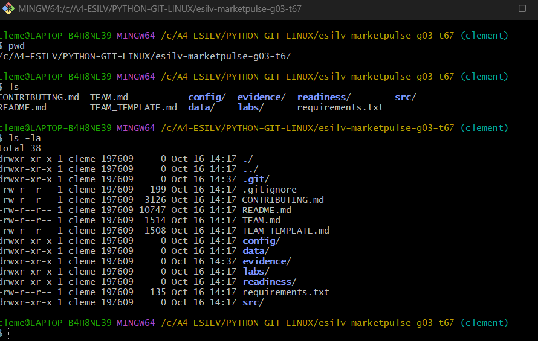
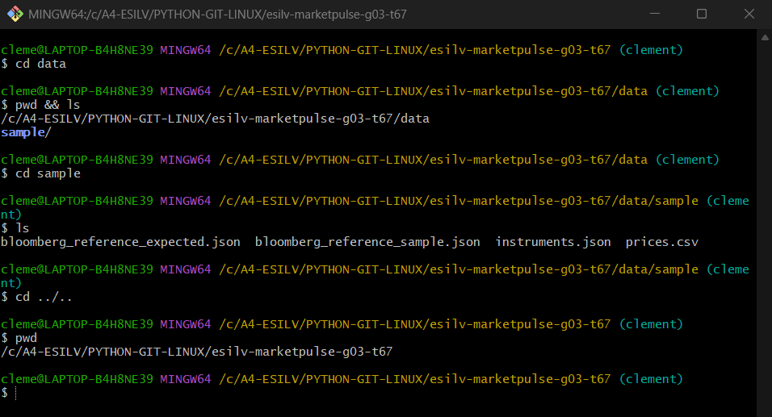
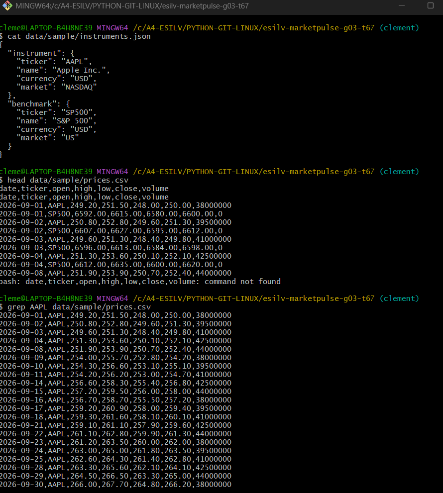
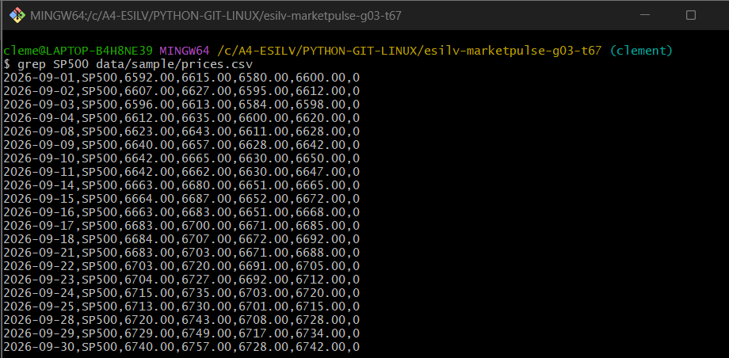
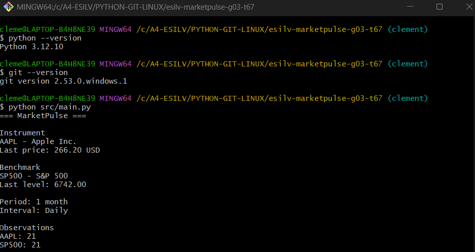

# TD01 - Bootstrap + Linux : rapport


| Groupe TD | G03 |
| Équipe MarketPulse | T67 |
| Dépôt | `esilv-marketpulse-g03-t67` |
| Environnement | Git Bash (MINGW64) sous Windows |

## Objectif

Disposer d'un environnement Linux commun pour inspecter et exécuter le starter MarketPulse (AAPL comparé au S&P 500, sur 1 mois en données journalières, à partir d'un CSV).

## 1. Répertoire courant et contenu du dépôt

```bash
pwd
ls
ls -la
```



Observations :
- `pwd` affiche la racine du dépôt : `/c/A4-ESILV/PYTHON-GIT-LINUX/esilv-marketpulse-g03-t67`. Je travaille sur la branche `clement`.
- `ls` liste les fichiers et dossiers attendus : `README.md`, `config/`, `data/`, `evidence/`, `src/`, ainsi que `labs/` et `readiness/`.
- `ls -la` affiche en plus les fichiers cachés (`.git/`, `.gitignore`), les permissions, la taille et la date de chaque entrée.

## 2. Navigation vers les données

```bash
cd data
pwd && ls
cd sample
ls
cd ../..
pwd
```



Observations :
- `data/` contient un seul sous-dossier, `sample/`.
- `data/sample/` contient `instruments.json` et `prices.csv`, ainsi que deux fichiers de référence Bloomberg.
- `cd ../..` remonte de deux niveaux. `pwd` confirme qu'on est revenu à la racine du dépôt.

## 3. Métadonnées JSON

```bash
cat data/sample/instruments.json
```



- Instrument : `AAPL` (Apple Inc.), en USD, coté sur le NASDAQ.
- Benchmark : `SP500` (S&P 500), en USD, marché US.
- Les noms et les tickers sont stockés dans les champs `name` et `ticker` des objets `instrument` et `benchmark`.

## 4. Prix CSV

```bash
head data/sample/prices.csv
grep AAPL data/sample/prices.csv
grep SP500 data/sample/prices.csv
```

La sortie de `head` et de `grep AAPL` est visible sur la capture précédente. Celle de `grep SP500` :



Observations :
- Les colonnes sont `date, ticker, open, high, low, close, volume`.
- Le fichier mélange les deux séries, qui alternent jour par jour (une ligne AAPL, une ligne SP500).
- `grep` permet d'isoler chaque série. On obtient 21 séances, du 2026-09-01 au 2026-09-30, pour AAPL comme pour SP500.


## 5. Versions de Python et de Git, et exécution de MarketPulse

```bash
python --version
git --version
python src/main.py
```



- Python : 3.12.10
- Git : 2.53.0.windows.1
- `python src/main.py` produit exactement la sortie attendue : AAPL au dernier cours de 266.20 USD, SP500 au dernier niveau de 6742.00, 21 observations pour chaque série.
